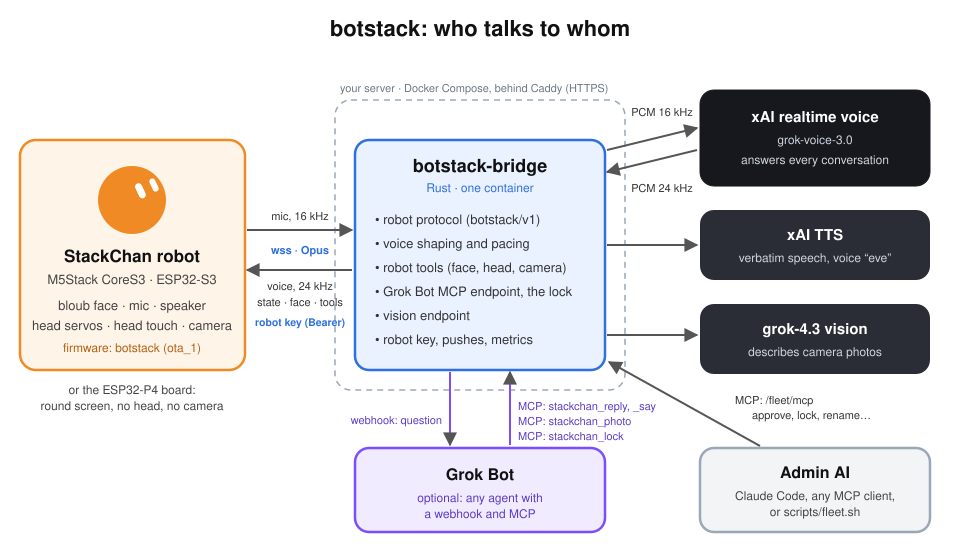

# botstack documentation

botstack gives the [M5Stack StackChan](https://shop.m5stack.com/products/stackchan-kawaii-co-created-open-source-ai-desktop-robot) robot (and the
[Waveshare ESP32-P4-WIFI6-Touch-LCD-4C](https://www.waveshare.com/product/esp32-related/boards-kits/esp32-p4/esp32-p4-wifi6-touch-lcd-3.4c.htm) round board, 4-inch version) its own stack: an
ESP-IDF firmware with the bloub face, and a Rust bridge that connects it to xAI's Grok
realtime voice. These pages
explain how the pieces fit, with one picture each.

| Page | Read it to understand |
| --- | --- |
| [Architecture](architecture.md) | The parts, where they run, and which model answers |
| [A conversation](conversation.md) | What happens from the tap to the robot falling silent |
| [botstack/v1 protocol](protocol.md) | The messages between the robot and the bridge |
| [Audio](audio.md) | How your voice reaches Grok and how Grok's voice reaches the speaker |
| [Fleet](fleet.md) | Devices, their keys and approval, abilities, the conversation cap, health and the admin MCP |
| [Grok Bot](grok-bot.md) | Questions for the slow agent, its replies, pushed messages, photos and the lock |
| [Security](security.md) | The device keys, the tokens, signed updates, the limits and the lock |
| [Robot tools](robot-tools.md) | Face, head, camera and goodbye, driven by Grok |
| [The bloub face](face.md) | The face model, its 16 expressions and its animations |
| [Firmware](firmware.md) | The two boards (StackChan, P4), dual boot, signed updates over the air, tasks and cores, memory |
| [Running the bridge](deployment.md) | Docker Compose and Caddy, the data volume, every setting |

To install it from scratch, start with the [QUICKSTART](../QUICKSTART.md).

The diagrams are SVG. `tools/diagrams.py` regenerates most of them
(`python3 tools/diagrams.py img`, from `docs/`); `architecture.svg` and `audio-path.svg`
are drawn by hand, and `tools/expressions.py` renders the expression sheet from the
firmware source.
