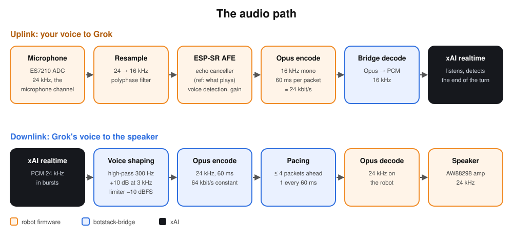

# Audio

## Uplink: your voice to Grok

| Stage | Where | Detail |
| --- | --- | --- |
| Microphone | robot | ES7210 ADC on a duplex I2S bus at 24 kHz. |
| Resample | robot | 24 → 16 kHz with our polyphase filter (−80 dB residual in band, tested on a computer). |
| AFE | robot | ESP-SR: echo cancellation (VoIP, low cost) against what the robot plays, automatic gain, voice detection. |
| Opus | robot | 16 kHz mono, 60 ms per packet, ~24 kbit/s, complexity 0. |
| Decode | bridge | Back to PCM 16 kHz for xAI. |

During a conversation the microphone stays on while the robot speaks: you can talk over
it (barge-in, below).

### Echo cancellation

The canceller needs a reference: what the speaker plays, and nothing else.

- The ES7210 has a loopback channel, but it carries the speaker about 40 dB under the
  microphone, and your voice at a similar level. Fed to the canceller, it made it erase
  your voice (once when the robot was silent, and again when you talk over it).
- So the reference is the played signal itself: the playback task resamples every block
  it writes to the speaker to 16 kHz and keeps it in a ring indexed by sample count.
- The capture task finds the echo delay by correlating the microphone's 10 ms envelope
  with the played envelope during the first second of speech (about 60–70 ms: mostly the
  I2S queue), then feeds the canceller the played samples one block early.
- Until that delay is known, the microphone sends silence while the robot speaks, so it
  never hears itself.
- Measured: the echo drops by 20–37 dB (microphone −20 to −25 dBFS, canceller output −41
  to −61 dBFS) at volume 70. `VOIP_HIGH_PERF` saturated core 1; `VOIP_LOW_COST` fits.

### Barge-in

While a conversation is open, the bridge sends `state speaking` with `mic: true`. xAI's
voice detection hears you over the robot; on `speech_started` the bridge cancels the
answer, drops the queued voice and sends `speech cancel`: the robot stops at once and
listens. During a pushed message (no conversation) the microphone stays off.

## Downlink: Grok's voice to the speaker

| Stage | Where | Detail |
| --- | --- | --- |
| xAI | cloud | PCM 24 kHz, in bursts of up to 1.5 s. |
| Voice shaping | bridge | High-pass at 300 Hz (xAI voices are bass-heavy, the small speaker buzzes on 150–300 Hz), +10 dB presence at 3 kHz, −6 dB gain, limiter at −10 dBFS (higher peaks made the board stutter). |
| Opus | bridge | 24 kHz, 60 ms, 64 kbit/s constant bitrate. |
| Pacing | bridge | `speech start`, a 60 ms gap, then one packet every 60 ms, at most four ahead; `speech end` once all are sent. |
| Decode, play | robot | Opus 24 kHz → AW88298 amp, the codec's native rate. `played` once the speaker has drained. |

## Verbatim speech

Grok Bot answers, pushed messages and the stall apology must be said word for word. They
go through xAI's `/v1/tts` (same voice), not the realtime session: its `force_message`
either blocked the next question after a tap or got cancelled by any speech and lost.
