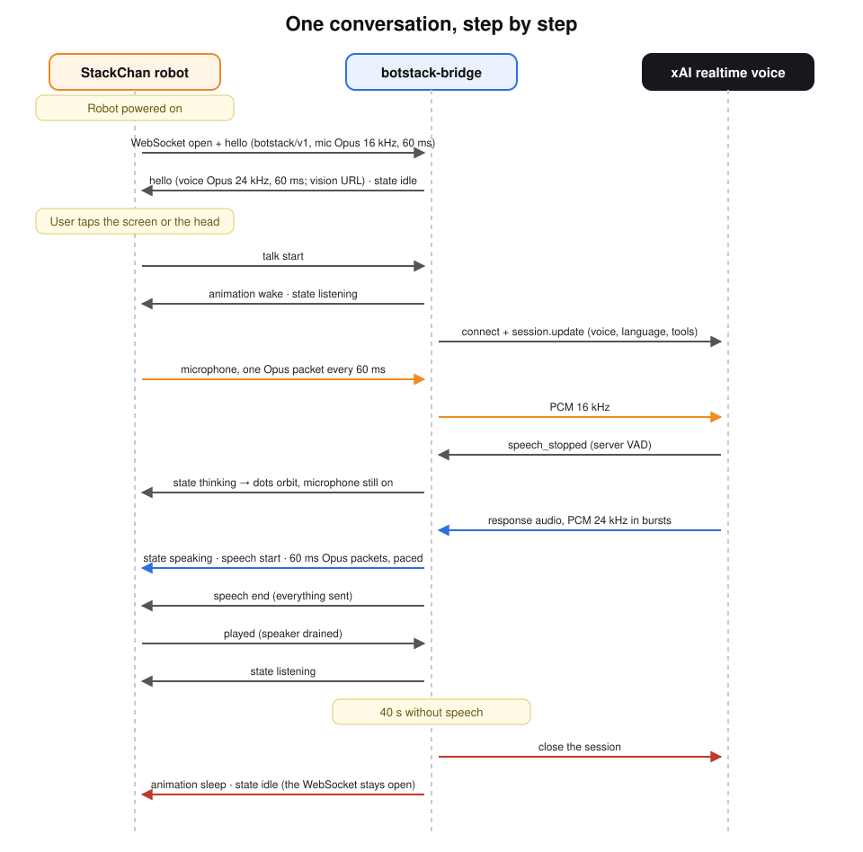

# A conversation

The robot keeps one WebSocket open to the bridge while it is powered
([botstack/v1](protocol.md)). A conversation opens and closes inside it.

## From tap to silence

1. **Connected.** At boot the robot connects and says hello (its microphone format); the
   bridge answers with the voice format (Opus, 24 kHz, 60 ms packets) and the vision URL,
   then `state idle`. If the link drops, the robot reconnects after 1, 2, 4 and 8 s; after
   20 s without hearing the bridge it restarts ([the link](protocol.md)).
2. **Tap.** You tap the screen or touch the top of the head; the robot sends `talk start`. The bridge plays the `wake`
   animation and sends `state listening`: the microphone turns on.
3. **Grok joins.** The bridge opens an xAI realtime session: voice, instructions
   (the device's language by default, English or French when you speak it or ask for it)
   with the current date and time (`TIMEZONE`), and the robot's tools. xAI sometimes takes seconds to
   confirm a session, so the bridge retries once and keeps up to ~19 s of your audio
   meanwhile.
4. **Listening.** The robot sends one Opus packet every 60 ms. The bridge decodes them
   and streams PCM to xAI.
5. **Your turn ends.** xAI's voice detection notices the silence and the bridge sends
   `state thinking`: dots orbit the face at once (the transcript can take a few seconds).
6. **Grok speaks.** Audio arrives in bursts. The bridge sends `state speaking` and
   `speech start`, shapes the voice, cuts it into 60 ms packets and sends them at playback
   speed, never more than four ahead.
7. **Back to listening.** `speech end` goes out once every packet is sent. The robot
   finishes playing and answers `played`; the bridge sends `state listening`.
8. **The end.** After 40 seconds without speech the bridge closes the xAI session, plays
   `sleep` and sends `state idle`; after a goodbye it plays `wink` instead. The WebSocket
   stays open.

## Taps

A tap on the screen and a touch on top of the head do the same thing. While the speaker
plays, a tap always interrupts, whatever the state the bridge last sent.

| When | A tap… |
| --- | --- |
| idle | starts a conversation (`talk start`) |
| listening or thinking | ends it (`talk stop`) |
| the robot speaks | interrupts it (`interrupt`): the speaker stops at once, the bridge cancels the answer and listening resumes |
| no link to the bridge | the face turns into a swaying “!” (`alert`) |
| the robot is locked | `alert` too; the bridge opens nothing ([lock](grok-bot.md#lock-d)) |

You can also just talk over the robot: it stops and listens ([barge-in](audio.md#barge-in)).

## Messages nobody asked for

A Grok Bot push, or a Grok Bot answer that arrives after the conversation closed, plays
the `notify` animation, a chime and the message, then listens for 10 s so you can answer.
During a conversation, pushes wait for its end. See [Grok Bot](grok-bot.md).

## When xAI is slow

xAI occasionally stalls (a 19 s gap was measured). The thinking face covers the wait;
after 25 s without audio the bridge cancels and apologises out loud (a second stall
closes the conversation). If xAI cannot be reached at all (two tries of 8 s), the face
plays `alert`, turns sad, and the conversation closes.
