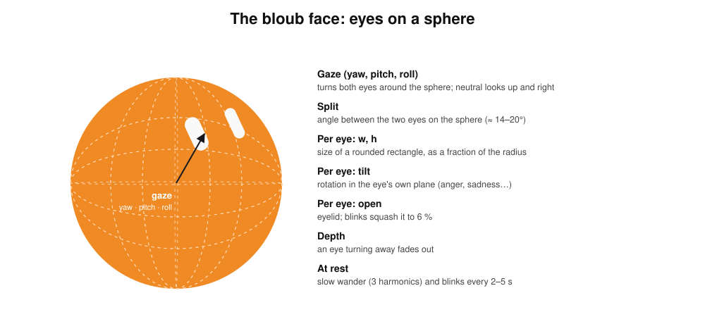
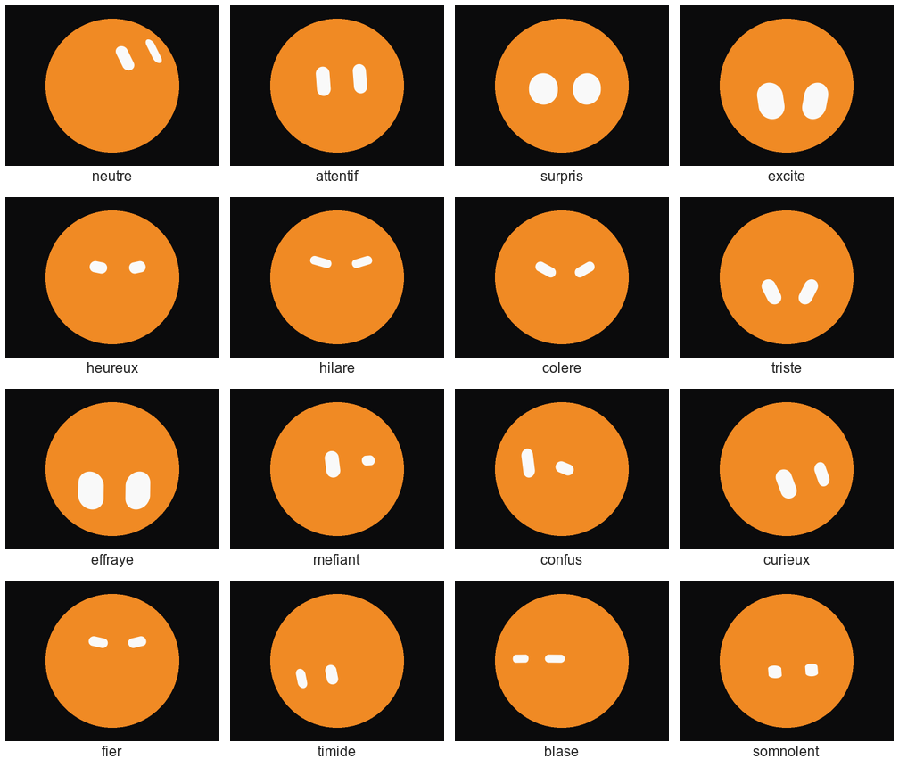

# The bloub face

The face is a port of [bloub](https://github.com/jeremy-prt/bloub)
([bloub.vercel.app](https://bloub.vercel.app)), Jérémy Perret's SVG recreation of the x.ai
bot avatar: an orange disc with two white eyes placed on a sphere. Its expression poses,
animation timings and wander/blink model come from bloub and are used under bloub's MIT
licence ([THIRD_PARTY_NOTICES.md](../THIRD_PARTY_NOTICES.md)).

## The model

Each expression is a handful of numbers:

- **gaze** (yaw, pitch, roll): turns both eyes around the sphere. Neutral looks up and to
  the right.
- **split**: the angle between the two eyes on the sphere.
- per eye **w, h**: a rounded rectangle, as a fraction of the radius; **tilt**: rotation in
  the eye's own plane; **open**: the eyelid.

An eye is projected onto the sphere's local axes, so it narrows as it turns away and fades
out behind the edge. Changing expression blends every number with an ease-in-out over
350 ms. At rest the gaze wanders (three harmonics of slow sines) and the eyes blink every
2–5 s, sometimes twice.

## The 16 expressions

Grok picks them with `set_expression`; the bridge passes the id straight to the firmware
(`expression` message).

## States

| State | Face |
| --- | --- |
| idle | full wander, blinks |
| listening | calmer gaze |
| thinking | looks up and left, three small dots orbit the disc |
| speaking | the eyes bob with the voice level |
| sleeping | eyes closed, slow breathing |

The bridge sets the state (`state` message); the robot never guesses it.
While the microphone streams (listening, thinking, and speaking during a conversation, for
barge-in), a small blue microphone shows in the top-right corner. While the robot is
locked, the bridge keeps it on the wary face (`mefiant`).

## Animations

One-shot states from bloub, played over the current expression and blended in and out.
Timings and poses are bloub's.

| Animation | Face | Played when |
| --- | --- | --- |
| `wake` | wide eyes, 1 s | a tap opens a conversation |
| `notify` | looks down-left; a blue badge pops on the upper-right edge, notched into the disc, 2.2 s | a pushed message is about to be spoken |
| `wink` | one eye flattens, 1.6 s | after a goodbye, or Grok's `animate` |
| `wide` | big eyes looking up, 1.8 s | every photo (with the shutter click), or Grok's `animate` |
| `exclaim` | the eyes fade and the disc morphs into a “!”, 2 s | Grok's `animate` |
| `alert` | the same “!”, swaying, 2.4 s | xAI is unreachable, a tap with no link to the bridge, or a tap while locked |
| `sleep` | eyes close, the face floats, 2.4 s | the conversation closes for silence |

For the “!”, the eye canvas is hidden while the disc reshapes: it is a child of the disc,
and moving or redrawing the whole ARGB canvas every frame starves the LVGL core.

## Drawing it on the robot

LVGL has no skewed rounded shape, so both eyes are rasterised by our code into one fixed
200×200 ARGB canvas over the disc, with anti-aliasing from a signed distance. Only the
boxes the eyes leave and enter are redrawn: blending ARGB onto the RGB565 panel is the
costly part, and audio shares the core.
