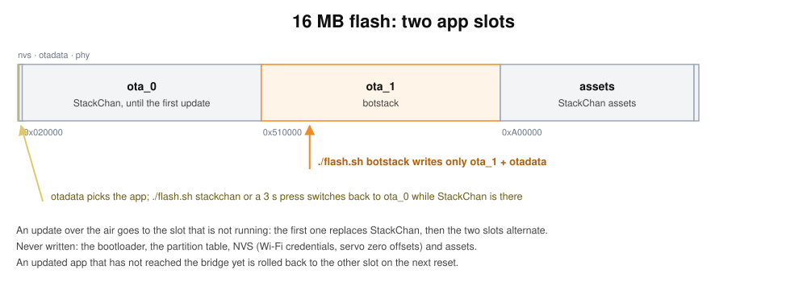
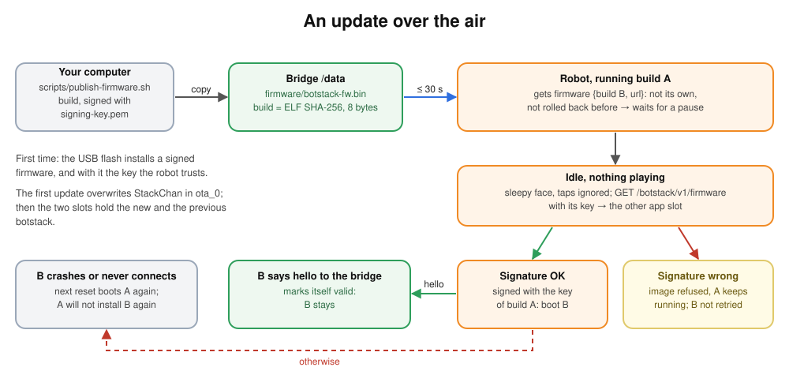
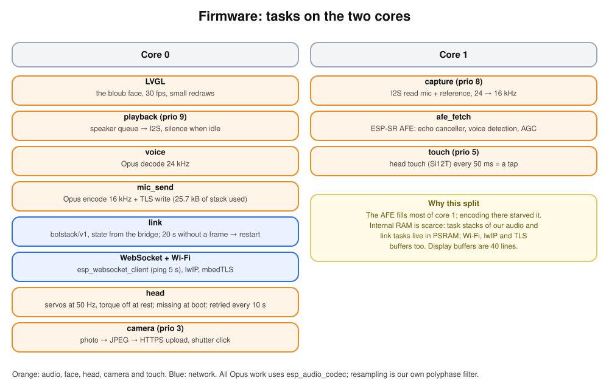

# Firmware

ESP-IDF 5.5.4. The StackChan firmware uses Espressif's `m5stack_core_s3` board support
package, the P4 firmware Waveshare's. The rest of this page describes the StackChan firmware
unless it says otherwise; the [P4 board](#the-p4-board) has its own section.

## Two boards

botstack runs on two boards. The code they share lives in one ESP-IDF component,
`firmware/components/botstack/` (face, audio pipeline, Opus, Wi-Fi, the
[botstack/v1](protocol.md) link, updates). Each board is its own project with its own
`main`:

| | StackChan (`firmware/`) | P4 (`firmware-p4/`) |
| --- | --- | --- |
| Board | M5Stack CoreS3 (ESP32-S3) on the [StackChan](https://shop.m5stack.com/products/stackchan-kawaii-co-created-open-source-ai-desktop-robot) | [Waveshare ESP32-P4-WIFI6-Touch-LCD-4C](https://www.waveshare.com/product/esp32-related/boards-kits/esp32-p4/esp32-p4-wifi6-touch-lcd-3.4c.htm) (4-inch 720×720 version; ESP32-P4 chip v1.3) |
| Project (`hello`) | `botstack-fw` | `botstack-p4` |
| Screen | 320x240, `screen:rect-320x240` | 720x720 round panel (JD9365, GT911 touch), `screen:round-720`; the face disc is 600 px, laid out for a round screen |
| Head, camera | servos and GC0308 | none (`HeadPort` and `CameraPort` are null) |
| Codec | `m5_codec` (AW88298, ES7210) | `p4_codec` (ES8311 and ES7210 through the Waveshare BSP), 24 kHz |
| Wi-Fi | the on-chip radio, networks from the StackChan's NVS | through the on-board ESP32-C6 (esp_hosted over SDIO), networks from its `wifi_nvs` partition, written by USB from `wifi.txt` |
| Flash | 16 MB, dual boot with StackChan | 32 MB, two 8 MB slots, table at 0x10000 |
| First flash | `firmware/flash.sh botstack` | `firmware-p4/flash.sh` |

The component asks the board for three things: a `Codec` (what the speaker and microphone
are), a list of networks (`std::vector<net::Network>`), and optionally a `HeadPort` and a
`CameraPort` ([botstack_board.h](../firmware/components/botstack/botstack_board.h)). `net::Link` takes the
two ports as pointers; a null one makes the bridge answer "Not available on this
firmware." to the head and camera tools, and `status` reports `none`. A change in the
component rebuilds and affects both firmwares: build both before committing it, and never
change what the StackChan does without meaning to.

Both firmwares share the signing key, the bootstrap key and the update path. The `hello`
announces the project of the running firmware (`esp_app_desc_t`), so the bridge offers each
board its own image. A hard-coded `botstack-fw` once made the bridge offer the P4 the
StackChan image; the firmware's project-name check refused it (and the image's chip id,
S3 against P4, would have refused it at the end of the download). Between two boards on the
same chip, the project name is the only guard: the fleet has one signing key.

### The P4 board

- **Chip v1.3.** The board carries a v1.3 chip, so `CONFIG_ESP32P4_SELECTS_REV_LESS_V3=y`
  (with `ESP32P4_REV_MIN_100`) is needed, and PSRAM runs at 200 MHz.
- **BSP.** `waveshare/esp32_p4_wifi6_touch_lcd_xc` sets up the display (MIPI DSI), touch,
  I2C and the two codecs. Its LVGL adapter is `esp_lvgl_adapter`: `bsp_display_lock(0)` only
  *tries* the lock there, so `main.cpp` calls `esp_lv_adapter_lock(-1)`, which blocks, around
  the face's setup.
- **Wi-Fi through the C6.** The P4 has no radio. An ESP32-C6 on the board runs Espressif's
  esp_hosted slave and the P4 reaches it over SDIO (esp_hosted 1.4.7, `esp_wifi_remote`),
  so `esp_wifi_*` calls are RPCs. Do not call esp_hosted before the C6 link is up: 1.4.7
  asserts in `tlsf_free` after a failed first transmit. The C6's factory firmware is old (it
  does not know the firmware-version call) but its Wi-Fi works; it has not been updated.
  The C6 does **2.4 GHz only**.
- **`wifi.txt` and `wifi_nvs`.** `firmware-p4/wifi.txt` (gitignored, never committed) lists
  the networks. It only feeds the USB flash: `flash.sh` turns it (`wifi_nvs.py`, in memory,
  no CSV) into `build/wifi_nvs.bin` (mode 600, gitignored) and writes it into the `wifi_nvs`
  partition: NVS namespace `wifi`, keys `ssid`/`password`, `ssid1`/`password1`… up to 10
  networks, the StackChan firmware's format. The app image holds no network, so an update
  over the air never carries a password, and a change of network means `flash.sh` again.
  The firmware reads the partition read-only (`readonly` in `partitions.csv`, through the
  shared `net::saved_networks("wifi_nvs")`). One network per line, `ssid<TAB>password`; the
  tab is required. `ssid<TAB>` alone is an open network (the only board that joins open
  networks). Only a trailing CR is dropped (a password may end with a space); blank lines
  and lines whose first non-blank character is `#` are skipped. A line without a tab, an SSID
  over 32 bytes, a password over 64 bytes, or an eleventh network is skipped, and the script
  names only its line number (never its content, which may be a password); without a valid
  line the flash stops. List at least one 2.4 GHz network: a 5 GHz-only network shows up as
  "no saved network answered". Like the StackChan, the board never gives up on Wi-Fi: sad
  face for 30 s, then it tries again.
- **Device-Id.** The P4 has no native Wi-Fi MAC, so the `Device-Id` is its eFuse base MAC
  (`esp_read_mac(ESP_MAC_BASE)`), available before Wi-Fi is up. It is not the C6's MAC. The
  board announces `["enroll","status","reboot","screen:round-720"]`.
- **Partitions.** `partitions.csv` puts the table at 0x10000 (the bootloader, with rollback
  and signed-app checks, no longer fits in 0x6000 bytes), then `nvs` (the board's own key),
  `otadata`, `phy_init`, `wifi_nvs` (0x1a000, read-only), `ota_0`, `ota_1` (8 MB each) and
  `coredump` (a crash leaves an ELF core dump there; `idf.py coredump-info` reads it). There
  is no StackChan to keep, so the USB flash writes the bootloader, the table, the app and
  `wifi_nvs` in one esptool run; it never erases the flash and never writes `nvs`, so the
  board keeps its key. Updates over the air then alternate the two slots and roll back as
  on the StackChan. An update that cannot start restarts while it is still pending, so the
  bootloader goes back to the version before: when the display or the audio fails, or after
  3 Wi-Fi rounds without a network (about 4 minutes). A firmware flashed by USB is never
  pending: it stays and shows the sad face.
- **Round screen.** `Face::init(screen, 600, true)`: the thinking dots, the notify badge and
  the microphone icon (at -45 degrees, not in the corner) stay inside the visible circle.
- **Serial.** Opening the serial port resets the P4: do not open it while testing something
  that must keep running. Each capture is bounded, as on the StackChan.
- **Memory.** About 350 kB of internal RAM is free at idle (the StackChan has 80 kB) and
  28 MB of PSRAM; the `health` line is the same.

```sh
scripts/setup.sh              # once: firmware/robot-token and firmware/bridge-url, which the build embeds
# edit firmware-p4/wifi.txt   (ssid<TAB>password, a 2.4 GHz network; gitignored)
firmware-p4/flash.sh          # build (signed), write bootloader, table, app and networks by USB
scripts/publish-firmware.sh firmware-p4   # later versions: over the air
```

The board enrolls like any new device: it shows up `pending` in `fleet_list`, then
`fleet_approve` gives it a name ([adding a device](fleet.md#7-adding-a-device)).

## Two firmwares side by side (StackChan)



The USB flash puts botstack in `ota_1`, next to the StackChan firmware in `ota_0`. Both
use the same partition table, so nothing else moves. The first [update over the
air](#updates) goes to `ota_0` and replaces StackChan; from then on the two slots hold the
running botstack and the one before it.

```sh
cd firmware
./flash.sh botstack    # build (signed), write ota_1, boot it
./flash.sh stackchan   # boot ota_0 again: StackChan, until an update replaced it
```

`flash.sh` first reads the robot's partition table (read-only) and writes nothing unless
`nvs`, `otadata`, `ota_0`, `ota_1` and `assets` sit where M5Stack's StackChan firmware puts
them (`ota_1` at 0x510000, 0x4f0000 long; the same table as `partitions.csv`). It writes
only the app partition and `otadata`. It never touches the bootloader,
the partition table, NVS (Wi-Fi credentials, servo zero offsets) or the assets partition.
While `ota_0` still holds StackChan, a 3 s press on the screen also goes back to it;
afterwards the press only shows “StackChan replaced”. M5Burner can always restore the
factory firmware over USB.

## Updates



```sh
scripts/publish-firmware.sh firmware      # build, sign, put it on the bridge's /data
scripts/publish-firmware.sh firmware-p4   # the same for the P4 board
```

1. The script builds the firmware, checks that it is signed and that its project matches,
   and copies it into the bridge's data volume through `docker compose exec`
   (`/data/firmware/<project>.bin`; for this firmware `botstack-fw.bin`), written to a
   temporary file then renamed.
2. Within 30 s, the bridge sends the robot `firmware {build, url}`. A build is the first
   8 bytes of the image's ELF SHA-256, in hex; the robot reports its own in its `hello`.
3. If the build is not its own, the robot waits for a pause (idle, nothing playing),
   shows the sleepy face and ignores taps, downloads the image from
   `/botstack/v1/firmware` with its key, into the other app slot.
4. ESP-IDF checks the signature, then selects the slot; the robot restarts (about 30 s in
   all).
5. The new firmware keeps itself when the bridge's `hello` arrives. If it crashes or never
   reaches the bridge, the next reset (the link's 20 s watchdog, or a power cycle) boots
   the version before, and that version does not install the same build again.

**Signature.** The robot has no hardware secure boot; instead each firmware is signed
(RSA-3072, the Secure Boot V2 scheme) with `firmware/signing-key.pem`, and an update is
installed only if it is signed with the key of the firmware that runs. The USB flash
installs the first signed firmware, and with it the key; the first flash script that runs
creates the key (`scripts/signing-key.sh`, never replacing one). The key is gitignored,
mode 600, never printed: keep a copy outside the computer. Without it, the next firmware goes in by USB with a new key. The bootloader on
the robot is not changed.

A build that failed to download or was refused is not tried again until the robot
restarts. Updates need the bridge's hello, so a robot that cannot reach the bridge cannot
be updated over the air: use USB.

## Tasks and cores



## Memory

Internal RAM is the scarce resource. What it took to fit Wi-Fi, TLS, the AFE and the face:

- Wi-Fi, lwIP and mbedTLS buffers in PSRAM.
- Display buffers of 40 lines instead of 100.
- The stacks of our audio and link tasks in PSRAM
  (`xTaskCreatePinnedToCoreWithCaps`); without that the WebSocket client could not even
  create its task.
- LVGL allocates with the C library, so the eye canvas lands in PSRAM.
- Only `malloc` calls under 512 bytes go to internal RAM first (the default is 16 kB).
  Drivers that need internal or DMA memory ask for it.
- Software AES: hardware AES takes an internal DMA bounce buffer for every TLS record held
  in PSRAM, and that allocation failed during a photo, which dropped the link.

At rest about 80 kB of internal RAM is free. A photo takes about 45 kB of it while the
camera streams; the upload barely touches it.

The microphone task uses 25.7 kB of its 40 kB stack: Opus encoding and the TLS write
happen in the same task.

The camera driver allocates its DMA bounce buffer in internal RAM each time the stream
starts. The default 32 kB was not free once Wi-Fi and TLS were up; it is 16 kB. The frame
buffers are in PSRAM. If the stream ever fails to start, esp_video leaves both buffers
queued and photos keep failing until the robot restarts: esp_video has no way to take
them back short of a restart (asking for new buffers would leave dangling list entries).

## Long serial logs

To catch leaks or errors that show up after hours, record the console on the computer the robot is plugged into
(it needs pyserial):

```sh
python3 -I firmware/serial-log.py                    # until Ctrl-C
PORT=/dev/ttyACM0 python3 -I firmware/serial-log.py  # when several ports are plugged in (or --port)
python3 -I firmware/serial-log.py --summary out/serial/robot-….log
```

The recorder writes `out/serial/robot-YYYYMMDD-HHMMSS.log` with the computer's time on every
line. It opens the port with DTR/RTS low, so it does not reset the robot, and it reopens
the port after a reset or an unplugged cable. `flash.sh` refuses to run while it holds the
port.

The firmware helps it:

- The boot line says why the robot restarted (`reset: panic`, `task watchdog`, `brownout`…).
- Every minute a `health` line gives the free internal RAM, its lowest point since boot
  (`min`) and its largest free block, the largest DMA-capable block, the same three for
  PSRAM, and the number of tasks.

For a diagnosis only: with `CONFIG_FREERTOS_USE_TRACE_FACILITY` and
`CONFIG_FREERTOS_GENERATE_RUN_TIME_STATS` switched on in the local `sdkconfig` (not in
`sdkconfig.defaults`), a `load` line every 5 s gives the idle share of each core and the
six busiest tasks. Switch them off again afterwards: they cost on every context switch. Measured on 2026-10-09:
core 0 is 35 % idle at rest (LVGL takes about half of it) and 1–5 % idle during a
conversation (`mic_send` about 40 %, `voice` 15–25 %); the head task stays under 1 %.

The summary lists the boots and their reasons, crash lines, and the most frequent errors
and warnings. For each boot it shows first, last, lowest and trend per hour of each memory
figure. A `min` or `largest` that keeps falling hour after hour is a leak or fragmentation;
a free figure that goes down during a conversation and comes back after it is not.

## The bootstrap key and the bridge URL

`components/botstack/CMakeLists.txt` embeds two gitignored files that `scripts/setup.sh`
writes (mode 600); the build stops when one is missing:

- `firmware/robot-token`, the **bootstrap key**: the same in every image, and
  `ROBOT_TOKEN` in the server's `.env`. The link sends it as `Authorization: Bearer` next to
  `Device-Id` until the device has a key of its own. Never log the link's headers: the link
  silences ESP-IDF's `transport_ws` logger, whose error path prints the whole upgrade
  request. The key sits in clear in the app image: anyone with the device and a USB cable
  can read it, so rotate it if a device leaves your hands: empty `ROBOT_TOKEN` in `.env`,
  delete `firmware/robot-token`, run `scripts/setup.sh` (it makes a new one and writes
  both), `docker compose up -d` to give the bridge the new value, then flash or publish the
  firmware again. Devices that already have their own key keep working.
- `firmware/bridge-url`, one line: `wss://<your domain>/botstack/v1`. Both boards connect
  there. A URL that does not start with `wss://` is refused at boot: the face turns sad and
  the device does nothing else until it is flashed again. The firmware checks the server's
  certificate against ESP-IDF's bundle of public roots, so the bridge needs a publicly
  trusted certificate (Caddy gets one from Let's Encrypt).

## Own key

Once the owner approves the device ([fleet](fleet.md)), the bridge sends `enroll {key,
id}`. The firmware keeps the key in NVS, namespace `botstack`, key `key`; it is the only
thing the firmware ever writes to NVS (`wifi` and `servo` stay read-only).

- `Link::start` reads the key from NVS (it runs in the network task, internal stack) and
  falls back to the bootstrap key when none is stored.
- The WebSocket event handler only hands the key to the control task (it must not take the
  send mutex). The control task starts a short task whose stack is in internal RAM, which
  writes it (`nvs_set_str`, `nvs_commit`): a task with a PSRAM stack cannot write the
  flash, as for `keep_firmware`. Then the control task sends `enrolled {id}`. The new key
  is used from the next connection.
- A 401 on the upgrade (`esp_ws_handshake_status_code`) while the link uses the NVS key
  erases it (same kind of task) and switches to the bootstrap key. A revoked device thus
  comes back as `pending`; a reset one gets a new key.

## Status, reboot and features

After `hello`, then every 60 s, the link sends `status`: RSSI, free internal RAM and
PSRAM, uptime, `esp_reset_reason()`, and the state of the head and the camera. `reboot`
takes the path of an update: wait for the end of the conversation, then `esp_restart()`.
The `hello` announces `features`: `enroll`, `status`, `reboot`, `head`, `head_touch`,
`camera`, `screen:rect-320x240`. A pending device only shows the confused face until the
bridge approves it.

## Wi-Fi

botstack reads the networks the StackChan firmware saved (NVS namespace `wifi`,
`ssid`/`password`, then `ssid1`… up to 9; `net::saved_networks`), read only, joins them
with WPA2 at least, and keeps its own Wi-Fi settings in RAM so it never writes the robot's
NVS. (The P4 reads the same format from its `wifi_nvs` partition, [above](#the-p4-board).) It never gives up: if no network answers within
60 s, the face turns sad for 30 s and it tries again (after a power cut the router can
come back after the robot).

## The head

The servos sit on a half-duplex serial bus (UART1, 1 Mbit/s, GPIO 6 TX, GPIO 7 RX). Their
power is pin 0 of the PY32 IO expander in the base (I2C 0x6F, on the internal bus with
the codec), which the firmware switches on at boot. Moves go out as one broadcast
`SYNC WRITE` for both servos every 20 ms (no reply to wait for); positions are read only
at boot and when a move starts after the torque was released. The StackChan firmware
can leave the yaw servo in PWM mode (angle limits both 0); botstack restores its
0–1023 range at boot. If the expander or a servo does not answer at boot, the head
task tries again every 10 s; until then `head.set_angles` answers “The head does not
answer.” [Robot tools](robot-tools.md#the-head) has the motion itself.

The touch pad on top of the head is an Si12T (I2C 0x68, same bus), set up as the
StackChan firmware does (sensitivity level 3). A task on core 1, above LVGL, reads its
three zones every 50 ms; a finger landing on any of them counts as one tap on the screen,
and it must lift before the next one counts.

The speaker's stream buffer takes one writer at a time (`Audio::play` holds a mutex): the
voice task and the camera's shutter click both play into it.

## Source layout

| Path | What |
| --- | --- |
| `components/botstack/face/` | the bloub model and renderer, shared by both boards |
| `components/botstack/audio/` | codec interface, resampler, AFE pipeline, Opus |
| `components/botstack/net/` | Wi-Fi, the always-on [botstack/v1](protocol.md) link to the bridge (ping every 5 s, restart after 20 s without the bridge), the photo upload, [updates](#updates) (all three shared with the P4) |
| `components/botstack/botstack_board.h` | what a board may add: `HeadPort`, `CameraPort` |
| `main/m5_codec.*` | the CoreS3 board's codec (the networks are read from NVS by the shared `net::saved_networks`) |
| `main/camera/` | GC0308 through esp_video, one JPEG at a time |
| `main/head/` | the two SCS0009 servos (power, serial bus, smooth moves) and the head touch |
| `main/main.cpp` | wiring, taps, Wi-Fi retries, the way back to StackChan while it is there, the `health` log |
| `../firmware-p4/` | the [P4 board](#two-boards) |
| `serial-log.py` | long serial recordings and their summary |

## Hard-won facts

What the firmware learned the hard way. Keep these when you change it.

### Both boards

- **Internal RAM is the limit** (StackChan: about 80 kB free at idle). Before
  `SPIRAM_MALLOC_ALWAYSINTERNAL=512` and software AES it was 45 kB; at 16 kB a photo left
  603 bytes and the link's TLS read failed (`esp-aes: Failed to allocate memory`). Wi-Fi,
  lwIP and mbedTLS buffers are in PSRAM, display buffers are 40 lines, LVGL uses the C
  library malloc. The WebSocket client task needs internal RAM.
- **PSRAM stacks.** The audio and conversation tasks have PSRAM stacks
  (`xTaskCreatePinnedToCoreWithCaps`). Such a task must not `vTaskDelete` itself, and it
  cannot write the flash: NVS and otadata writes run in a short task whose stack is in
  internal RAM (`keep_firmware`, `key_task`).
- **The WebSocket event handler** never sends and never takes the send mutex
  (`client_lock_`): the client task holds its own lock there, and the microphone task
  holds `client_lock_` while it waits for that lock. Hand the work to the control task.
- **Never log a key.** The link silences ESP-IDF's `transport_ws` logger: its error path
  prints the whole upgrade request, bootstrap or own key included.
- **`mic_send`** uses 25.7 kB of its 40 kB stack (Opus encode + TLS write); it runs on
  core 0 at Opus complexity 0 because the AFE fills core 1.
- **One writer on the speaker.** The stream buffer allows one writer: `Audio::play` holds a
  mutex, because the voice task and the camera's shutter click both play.
- **Emptying the speaker queue.** `xStreamBufferReset` fails silently while a task is
  blocked on the buffer. The queue (4 s) is emptied through `flush_epoch_` instead: the
  playback task drains it and `Audio::play` stops writing.
- **Echo cancellation** uses the played signal as reference (a ring in `audio.cpp`, delay
  found by envelope correlation), never the ES7210 loopback channel: it carries the
  speaker about 40 dB under the microphone and the user's voice at a similar level, so the
  canceller erased the voice. Keep `AEC_MODE_VOIP_LOW_COST`: `VOIP_HIGH_PERF` saturated
  core 1 (AFE ring overflow, IDLE1 watchdog). Check `uplink (playing)` and `echo delay` in
  the serial log.
- **The face** redraws only the boxes the eyes leave and enter, on one fixed ARGB canvas;
  full canvas or arc redraws starved the LVGL core once audio was running. The “!”
  animations hide the canvas while the disc reshapes. LVGL asserts and spins on a null
  draw buffer: check allocations.
- **The bridge's `hello`** sets the neutral face in the WebSocket task, not the control
  task: an `expression` right after it (a locked device's `mefiant`) must win.
- **Wi-Fi never gives up** at boot (sad face, 30 s, try again); the link restarts the
  device after 20 s without a frame from the bridge, so its backoff stops at 8 s.
- **Rollback.** The bootloader rolls back an updated app that does not call
  `esp_ota_mark_app_valid_cancel_rollback()` before the next reset; botstack calls it when
  the bridge's `hello` arrives, and does not install a rolled-back build again.
- **The project name** in the `hello` comes from the app description. Between two boards
  on the same chip it is the only guard against the wrong image (one signing key for the
  fleet): keep it.
- **Run-time stats** (`CONFIG_FREERTOS_GENERATE_RUN_TIME_STATS`, the `load` log line) are
  for a diagnosis only; switch them off in the local `sdkconfig` afterwards.
- **Serial captures.** Opening the port can reset the board. Open it with DTR/RTS low
  (pyserial), read for a bounded time, close it; never leave a monitor running and never
  run two captures at once. While `serial-log.py` records, read its file in `out/serial/`
  instead, and do not flash. Decode backtraces with
  `xtensa-esp32s3-elf-addr2line -pfiaC -e build/botstack-fw.elf …` (StackChan) or
  `riscv32-esp-elf-addr2line` and `build/botstack-p4.elf` (P4).
- **ESP-IDF 5.5.4 only.** The activation script refuses to be sourced from a script whose
  name it does not know, so the scripts wrap each command in `bash -c`. If another ESP-IDF
  is first in your `PATH`, plain `clang++` may be its toolchain: use the system compiler
  (`/usr/bin/clang++`) for host-side C++ tests.

### StackChan (CoreS3)

- **Dual boot.** Never erase NVS, never full-chip erase, never write the bootloader, the
  partition table or `assets`: NVS holds the Wi-Fi networks and the servo zero offsets,
  and M5Burner must still be able to restore the factory image. The firmware writes only
  NVS namespace `botstack` (its own key); `wifi` and `servo` stay read-only, and its own
  Wi-Fi settings live in RAM (`WIFI_STORAGE_RAM`).
- **Camera:** 320×240 YUYV only. At 640×480 the DVP copy task overflowed (`D-ISR OVF`)
  while audio ran, and the photos came out torn and dark. Keep `CAM_CTRL_DVP_LOG_ENABLE`
  off (it prints from the interrupt) and the DVP DMA buffer at 16 kB (internal RAM,
  allocated at each stream start). If `VIDIOC_STREAMON` fails, esp_video keeps both
  buffers queued and photos fail until a restart; `REQBUFS` would not clear its queued
  list (dangling entries).
- **Head:** SCS0009 servos on UART1 (1 Mbit/s, GPIO 6/7), ids 1 yaw and 2 pitch, powered
  by pin 0 of the PY32 IO expander (I2C 0x6F). The zeros are read from NVS `servo`, never
  written. Positions stream as broadcast sync writes every 20 ms; the torque goes off
  after 1 s at rest so the servos do not hum into the microphone. A head that does not
  answer at boot is retried every 10 s (it once stayed dead for a whole session).
- **Head touch:** Si12T at I2C 0x68, polled every 50 ms by a task on core 1 at priority 5;
  at priority 2 on core 0 it missed touches while the robot spoke (core 0 is 2–5 % idle
  then). A touch is a screen tap (`Link::tap`); `Link::post` drops events until the link
  has started. A tap while the speaker plays always interrupts, whatever the state, and
  `Link::tap` silences the speaker in the caller's task: the control task lags by up to
  0.8 s while the robot speaks.
- **Board:** 16 MB flash, 8 MB PSRAM, codec at 24 kHz.

### P4 board

- **Chip v1.3:** `CONFIG_ESP32P4_SELECTS_REV_LESS_V3=y` is required. The partition table is
  at 0x10000: the bootloader (rollback, signed apps) overflows 0x6000 bytes.
- **USB flash:** `flash.sh` writes the bootloader, the table, the app and `wifi_nvs` in one
  esptool run with `--chip esp32p4`; it never erases the flash and never writes `nvs`
  (the board's own key). Only the P4's `main.cpp` may erase its own `nvs` (full, or a new
  NVS version), never `wifi_nvs`.
- **`wifi.txt`** holds Wi-Fi passwords: never print it, log it or commit it. It feeds only
  the USB flash; the app and update images never hold it.
- **An update that cannot start** (display, audio, 3 Wi-Fi rounds, about 4 min) restarts
  while it is still pending, so the bootloader goes back to the version before.
- **LVGL lock:** on this BSP `bsp_display_lock(0)` only tries the lock; take it with
  `esp_lv_adapter_lock(-1)`, which blocks.
- **esp_hosted 1.4.7** must not be called before the C6 link is up (`tlsf_free` assert,
  boot loop). The C6's factory firmware is old (no firmware-version RPC) but Wi-Fi works,
  2.4 GHz only.
- **Device-Id:** the shared component's `mac_address()` reads `ESP_MAC_BASE` where the chip
  has no Wi-Fi (`SOC_WIFI_SUPPORTED` is 0); the StackChan keeps `ESP_MAC_WIFI_STA`.
- **A crash** leaves an ELF core dump in the `coredump` partition (`idf.py coredump-info`).
