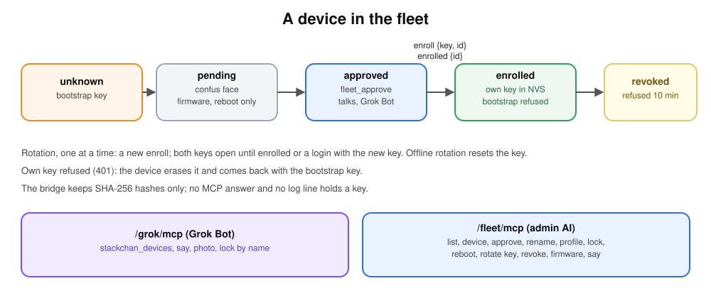

# Fleet

The bridge serves several voice devices, all yours: StackChan robots, and other boards
(the ESP32-P4 with a round touch screen, no head, no camera). Each device is known by a
name, has its own key and its own profile, and is managed over MCP by an AI. Everything
speaks [botstack/v1](protocol.md).



## 1. What a device is

| Property | Meaning |
| --- | --- |
| MAC | the identity on the link (`Device-Id`, lowercase); the key proves it |
| name | `[a-z0-9-]`, 1 to 32 characters, unique; used instead of the MAC everywhere |
| type | the firmware project the device sends in its `hello` (`botstack-fw` for the StackChan); images are published per project |
| features | what the hello announces: `enroll`, `status`, `reboot`, `head`, `head_touch`, `camera`, `screen:<shape>-<size>` |
| profile | xAI `voice`, `language`, `prompt_extra` (at most 500 characters, added to the instructions); applies from the next conversation |
| lock | per device ([Grok Bot](grok-bot.md#lock-d)) |

The registry is `/data/fleet.json`, written to `fleet.tmp` then renamed. One entry per MAC:
`name`, `status` (`pending` or `approved`), `key_sha256`, `key_pending_sha256`, `locked`,
`voice`, `language`, `prompt_extra`, `first_seen`, `last_seen`, `approved_at` (Unix
seconds). Keys are never stored in clear, only their SHA-256. A change that cannot be
saved is refused and changes nothing. A corrupt file stops the bridge at start (the log
names it) rather than reseed and lose the keys. A revoked device is removed from the file.
Live state (connection, last `status`, conversation, minutes) stays in memory.

On the first start without the file, the bridge creates it, empty, or, when
`GROK_DEVICE_ID` is set, with that MAC approved as `GROK_DEVICE_NAME` (default `stackchan`),
locked as `/data/lock` says; that file is not read afterwards.

## 2. Keys and lifecycle

Two kinds of key:

- **Bootstrap key**: `ROBOT_TOKEN`, embedded in every image. It only lets a device
  introduce itself.
- **Own key**: 64 random hex characters made by the bridge, kept by the device in NVS
  (`botstack/key`). The bridge keeps its SHA-256 only. Its `id` is the first 8 hex digits
  of that hash.

Lifecycle:

1. **Unknown to pending.** An unknown MAC connects with the bootstrap key and is recorded
   as `pending` (at most 20; an entry expires 24 h after it was last seen; a full list
   answers 429; a new entry that cannot be saved answers 503). A pending device gets
   `hello` (`approved: false`, no vision token), the `confus` expression, `firmware`
   offers and `reboot`, nothing else.
2. **Approved.** `fleet_approve <mac> <name>`. If the device is connected, it gets a
   second `hello` (`approved: true`, its name, the vision token) and, if it announces
   `enroll`, `enroll {key, id}` at once; otherwise both come right after its next
   `hello`. The hash waits in `key_pending_sha256`.
3. **Enrolled.** The device writes the key to NVS and answers `enrolled {id}`. The bridge
   confirms the key only if `id` matches the pending one, so a late answer to an older
   `enroll` confirms nothing. Until then the bootstrap key still opens the MAC, so a lost
   answer blocks nobody. A connection with the pending key confirms it too: the device
   proves it stored that key even if its `enrolled` was lost, and a later `enrolled` for
   it is accepted without a warning. Afterwards only the own key opens it; the bootstrap
   key gets 401.
   A device without the `enroll` feature keeps working with the bootstrap key.
4. **Rotation.** `fleet_rotate_key` on a connected device sends a new `enroll`; the
   confirmed and the pending key both open the MAC until `enrolled` (or the first
   connection with the new key). One rotation at a time: while a key is still on its way
   to a connected device, `fleet_rotate_key` refuses ("A key is already on its way to
   <name>; wait for it to confirm."). The firmware writes one key at a time too: a key
   that arrives while it writes is written next, so its NVS ends on the last key sent.
5. **Revocation.** `fleet_revoke` removes the entry, ends the connection and refuses the
   MAC (403) for 10 minutes. Afterwards it can come back as `pending`.

**Offline rotation is a reset.** On an offline device `fleet_rotate_key` clears its key
hashes. The device then connects with its old key, is refused once (401), erases the key
from NVS, comes back with the bootstrap key and gets a new key through the normal
lifecycle.

**The 401 fallback.** A device whose own key is refused (revoked, or reset) erases it from
NVS and uses the bootstrap key next time. Recovery when the bridge still holds a confirmed
key but the device lost its own (or never stored it): the device falls back to the
bootstrap key, is refused again, and restarts about every 20 s (it hears no frame from the
bridge). `fleet_rotate_key` on that offline device resets its key; the bootstrap key then
opens it and it gets a new key.

**Rolling the bridge back past the fleet.** A bridge from before the fleet knows only
`ROBOT_TOKEN`: it answers 401 to a device's own key, so the device erases its key from
NVS and comes back with the bootstrap key, which that bridge accepts. When the fleet
bridge is deployed again, it still holds the device's confirmed hash, refuses the
bootstrap key, and the device restarts about every 20 s. Run `fleet_rotate_key` for each
enrolled device right after that redeploy: the device is offline, so its
key is reset, and it gets a new one at its next connection.

**A pending device** is held back by the link itself: its `talk start` is refused with the
`alert` animation, messages for it (pushes, Grok Bot replies) are dropped, a photo request
is answered "waiting for approval", and it gets no push listen.

**Accepted risk.** Anyone with the bootstrap key who spoofs the MAC of an approved device
that has no confirmed key yet could receive that device's key. The window runs from the
approval to the first `enrolled`. Acceptable for a lab.

Limits: 20 pending devices, a pending entry lives 24 h after its last connection, a
revoked MAC is refused for 10 minutes.

## 3. Abilities

When a realtime session opens, the bridge builds it from the device's features:

| Feature | What Grok gets |
| --- | --- |
| `head` | tools `move_head` and `gesture`, and the hint about gestures |
| `camera` | tool `take_photo`, and the hint about photos |
| (none of them) | a round screen face, "you cannot move" in the instructions |
| always | `set_expression`, `animate`, `ask_grok_bot`, `end_conversation` |

The instructions also carry the device name and its `prompt_extra`. The device's `voice`
replaces the global `XAI_VOICE`; its `language` sets the spoken language. `keyterms` stay
shared. The photo upload (`/mcp/vision/explain`) also needs an approved device with the
`camera` feature, and `stackchan_photo` refuses a device without one.

**Legacy StackChan rule.** The firmware before the fleet sends `features: []`. A device
whose project is `botstack-fw` and whose list is empty is taken as `head`, `head_touch`,
`camera`, so it keeps its head and camera tools until it updates.

## 4. Conversation cap

`MAX_CONVERSATIONS` (default 3) caps the xAI sessions open at the same time, to bound the
bill. A conversation takes a slot when it opens its xAI session, and so does a push with
its 10 s listen. The slot is given back when the conversation is dropped, however the link
ends. When the cap is reached, `talk start` gets the `triste` expression and the line "I'm
busy, try again in a moment." (in the device's language), then `state idle`.

## 5. Health

A device with the `status` feature sends `status` right after `hello`, then every 60 s:
`rssi`, `heap_internal`, `heap_psram`, `uptime_s`, `reset_reason`, `head` and `camera`
(`ok`, `missing` or `none`). Read the last one with `fleet_device`. `fleet_list` shows
online state, the running and the published build, and the minutes of the day. `/metrics`
adds `botstack_realtime_seconds_total{device="<name>"}`, `botstack_devices_online` and
`botstack_conversations_active`.

## 6. The two MCP levels

Both are hand-written JSON-RPC (`initialize`, `tools/list`, `tools/call`). No key appears
in any answer: a device key goes from the bridge to the device over the link only. Both
are routed by Caddy.

**Usage: `/grok/mcp`** (Bearer `GROK_BRIDGE_TOKEN`, Grok Bot). The tool names did not
change; a `device_id` is a name or a MAC.

| Tool | Effect |
| --- | --- |
| `stackchan_devices` | name, type, online, locked, state and features of every approved device |
| `stackchan_say` | speak a text; `device_id` optional |
| `stackchan_photo` | a photo; refused for a device without `camera` |
| `stackchan_lock` | `device_id` optional; the whole fleet when omitted |
| `stackchan_reply` | unchanged; follows `request_id` to the device that asked |

Without `device_id`, `stackchan_say` and `stackchan_photo` go to `GROK_DEVICE_ID` when
that device is approved. They do not fall back to the only approved device: the
answer is "unknown device" when `GROK_DEVICE_ID` is unset or that device is not
approved. `stackchan_lock` without `device_id` is the whole fleet.
A `stackchan_reply` for an unknown request with no `device_id` goes to
`GROK_DEVICE_ID` when that device is approved, and, when `GROK_DEVICE_ID` is unset,
to the only approved device. An explicit `device_id` on the reply wins over
`GROK_DEVICE_ID`. The reply is refused (`unknown request and no default device`)
when there is no approved default, and it is not queued. A device that is not
approved, including one revoked after the question was asked, is not reported as
spoken and is not a queue.

**Admin: `/fleet/mcp`** (Bearer `FLEET_ADMIN_TOKEN`, another AI, or `scripts/fleet.sh`).
From the command line, one tool per call, arguments as a JSON object:

```sh
scripts/fleet.sh tools                                     # the tool names
scripts/fleet.sh fleet_list
scripts/fleet.sh fleet_approve '{"mac":"02:00:00:00:00:01","name":"desk"}'
scripts/fleet.sh fleet_set_profile '{"device":"desk","language":"fr","voice":"ara"}'
```

`scripts/fleet.sh` reads the token and the domain from `.env`; `BOTSTACK_URL` overrides
the address (`BOTSTACK_URL=http://127.0.0.1:8080` for a local bridge).

| Tool | Arguments | Effect |
| --- | --- | --- |
| `fleet_list` | none | every device, pending ones included: name, MAC, type, status, online, running and published build, minutes today |
| `fleet_device` | `device` | profile, features, last `status`, connected since, peer address, key confirmed or pending |
| `fleet_approve` | `mac`, `name` | pending to approved; `enroll` sent at once when connected |
| `fleet_rename` | `device`, `name` | rename |
| `fleet_set_profile` | `device`, `voice?`, `language?`, `prompt_extra?` | from the next conversation |
| `fleet_lock` | `device` or `all`, `locked` | lock or unlock |
| `fleet_reboot` | `device` | `reboot` sent; the device restarts between conversations |
| `fleet_rotate_key` | `device` | connected: new key sent, old key accepted until `enrolled`, refused while a key is still on its way; offline: key reset (section 2) |
| `fleet_revoke` | `device` | remove, disconnect, refuse the MAC for 10 minutes |
| `fleet_firmware` | none | published images per project (build, size, date) and devices behind |
| `fleet_say` | `device`, `text` | speak a text on a device, without Grok Bot |

`/fleet/mcp` answers 503 when `FLEET_ADMIN_TOKEN` is not set, and 401 for a wrong token.
Five wrong tokens within a minute from one client address make it answer 429 to that
address for a minute; other addresses are not affected ([security](security.md)). `fleet_reboot` and `fleet_rotate_key` on
an offline device do nothing, except the reset above; `fleet_say` and `stackchan_say`
queue the text in `grok_pending.json`.

Every admin call is logged with the tool, the device (the `mac` for `fleet_approve`) and
the outcome, never a key; the `enrolled` id is logged cut to 8 characters.

## 7. Adding a device

1. Build and flash an image that carries the bootstrap key (`firmware/robot-token`).
2. Power it. It connects and becomes `pending` (confused face).
3. `fleet_list` shows its MAC.
4. `fleet_approve` with its MAC and a name.
5. `fleet_device` shows `"key": "confirmed"` once it answered `enrolled`.

Worked example, the Waveshare P4 board (project `botstack-p4`):

1. Put a 2.4 GHz network in `firmware-p4/wifi.txt` (the board's ESP32-C6 has no 5 GHz) and
   run `firmware-p4/flash.sh`, which writes the networks into the board's `wifi_nvs`
   partition (never into the image the bridge serves). `firmware/robot-token` and
   `firmware/bridge-url` must exist (`scripts/setup.sh`).
2. The board connects with the bootstrap key; its `Device-Id` is its base MAC (the P4 has
   no Wi-Fi MAC of its own). It becomes `pending`.
3. `fleet_list` shows it with type `botstack-p4`, say as `02:00:00:00:00:02`:
   `scripts/fleet.sh fleet_approve '{"mac":"02:00:00:00:00:02","name":"p4"}'`.
4. `scripts/fleet.sh fleet_device '{"device":"p4"}'` shows `"key": "confirmed"` once it
   answered `enrolled`; its features are `enroll`, `status`, `reboot`, `screen:round-720`
   (no `head`, no `camera`, so Grok gets the round-face instructions of section 3).
5. Later versions: `scripts/publish-firmware.sh firmware-p4`; only the P4 is offered
   that image.

To test without hardware, run `fake_robot` ([QUICKSTART](../QUICKSTART.md#develop-without-hardware));
for several fake devices, give each its own `--device` MAC and `--out`.

## 8. Firmware per project

The bridge serves `/data/firmware/<project>.bin`, picked by the project in the device's
`hello`; a device is never offered another project's image. Publish with
`scripts/publish-firmware.sh firmware` (StackChan) or `scripts/publish-firmware.sh
firmware-p4`: it checks that the image's project matches and that it is signed. One signing key,
`firmware/signing-key.pem`, signs every project ([updates](firmware.md#updates)).
