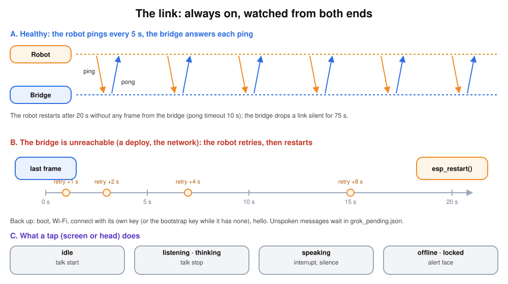

# botstack/v1 protocol

The robot keeps one WebSocket open to the bridge for as long as it is powered. Inside that
connection, conversations with Grok open and close; when none is open, the bridge can
still make the robot speak (pushed messages) or change its face.

```
wss://bot.example.com/botstack/v1       (firmware/bridge-url)
Device-Id: 02:00:00:00:00:01            (lowercase MAC of the device)
Authorization: Bearer <key>       (the device's own key, or the bootstrap key ROBOT_TOKEN)
```

Answers to the upgrade: 401 for a missing or wrong key, or for the bootstrap key once the
device has its own; 403 for a MAC revoked less than 10 minutes ago; 429 when 20 unknown
devices already wait for approval; 503 when a new pending entry could not be saved. An
unknown MAC with the bootstrap key connects as `pending`. The same headers fetch the published firmware: `GET /botstack/v1/firmware`
(404 when none is published; it serves the image of the project the device announced in
its last `hello`; [updates](firmware.md#updates)). Keys and lifecycle: [fleet](fleet.md).

The bootstrap key is a random 64-character secret (`scripts/setup.sh`): `ROBOT_TOKEN` in
the server's `.env` for the bridge, and embedded in every firmware image at build time from
the gitignored `firmware/robot-token`. Each approved device then gets a key of its own. The MAC
alone is no proof: it travels in clear in every Wi-Fi frame.

- **Text frames** are JSON objects with a `type`.
- **Binary frames** are one raw Opus packet each: robot → bridge is the microphone
  (16 kHz mono, 60 ms), bridge → robot is the voice (24 kHz mono, 60 ms).
- The robot sends WebSocket pings every 5 s. The bridge drops a connection that has been
  silent for 75 s; the robot reconnects after 1, 2, 4 then 8 s, and restarts when nothing
  (not even a pong) has come from the bridge for 20 s. A newer connection from the same
  robot replaces the older one, which ends with its xAI session.
- Both sides answer `hello` within a few seconds (bridge 5 s, robot 6 s) or drop the link.



## Robot → bridge

| type | fields | when |
| --- | --- | --- |
| `hello` | `protocol: "botstack/v1"`, `firmware`, `build` (16 hex digits), `mic` and `speaker` formats, `features` (`enroll`, `status`, `reboot`, `head`, `head_touch`, `camera`, `screen:<shape>-<size>`) | first frame after connecting |
| `talk` | `action: "start" \| "stop"` | the user taps the screen or touches the head: start a conversation, or end it while listening (any voice still playing is cancelled too) |
| `interrupt` | — | the user taps while the robot speaks |
| `played` | — | the speaker finished everything sent before `speech end` |
| `tool_result` | `id`, `ok`, `result` | answer to a `tool` request |
| `enrolled` | `id` | the key from `enroll` is written to NVS |
| `status` | `rssi`, `heap_internal`, `heap_psram`, `uptime_s`, `reset_reason`, `head`, `camera` (`ok`, `missing`, `none`) | right after `hello`, then every 60 s |

## Bridge → robot

| type | fields | effect on the robot |
| --- | --- | --- |
| `hello` | `protocol`, `voice` format, `name` (empty while pending), `approved`, `vision: {url, token}` (approved devices only) | ready; vision credentials for the camera. A device approved while connected gets a second `hello` with `approved: true`, its name and `vision` |
| `enroll` | `key` (64 hex digits), `id` (8 hex digits) | write the key to NVS, answer `enrolled {id}`, use it from the next connection (a connection with that key confirms it too) |
| `reboot` | none | restart between conversations, as for an update |
| `state` | `value: "idle" \| "listening" \| "thinking" \| "speaking"`, `mic: bool` | face state; the microphone streams while `mic` is true (listening, thinking, and speaking during a conversation, for barge-in) |
| `speech` | `action: "start" \| "end" \| "cancel"` | voice packets follow `start`; after `end` and playback, the robot sends `played`; `cancel` stops playback at once, then `played` |
| `expression` | `value`: one of the 16 bloub ids | the face blends to it (`mefiant` while locked, sent right after `hello`) |
| `animation` | `value`: `notify`, `wink`, `alert`, `exclaim`, `sleep`, `wake`, `wide` | a one-shot animated state on top of the current face |
| `firmware` | `build`, `url` | a firmware is published (after `hello`, and within 30 s of a new one); the robot installs it between conversations unless it runs that build or rolled it back ([updates](firmware.md#updates)) |
| `tool` | `id`, `name`, `args` | `head.set_angles {yaw, pitch, speed}` (degrees, speed 0–1000; answered at once with `Done.` or “The head does not answer.”, the head moves afterwards), `camera.take_photo {question}` (`question` is `botstack-photo:<key>` for a Grok Bot photo, which the bridge keeps instead of describing); the robot answers with `tool_result` |

**Pending device.** A device the owner has not approved gets `hello` with `approved:
false` and no `vision`, the `confus` expression, `firmware` offers and `reboot`. Its `talk start` is
refused with the `alert` animation; messages for it are dropped and photo requests are
answered "waiting for approval". It gets no push listen.

**Conversation cap.** When `MAX_CONVERSATIONS` conversations are open, `talk start` gets
the `triste` expression and a short TTS line in the device's language ("I'm busy, try
again in a moment."), then `state idle`.

**Features.** A device that sends `features: []` with the project `botstack-fw` (the
firmware before the fleet) is taken as `head`, `head_touch`, `camera`. See [fleet](fleet.md#3-abilities).

## Flows

**A conversation.** `talk start` → bridge opens an xAI realtime session, sends
`state listening` → microphone packets → xAI detects the end of the turn → `state
thinking` → `state speaking`, `speech start`, voice packets, `speech end` → robot drains
and sends `played` → `state listening`. After 40 s without speech, a tap (`talk stop`),
or `end_conversation`, the bridge closes the xAI session and sends `state idle`. The
WebSocket stays open.

**A pushed message** (Grok Bot `stackchan_say`, or a Grok Bot reply after the
conversation closed). If no conversation is open: `animation notify`, `state speaking`,
`speech start`, a chime then the message (xAI TTS), `speech end`, `played`, then a short
conversation opens and listens for 10 s so you can answer. If a conversation is open, the
message waits for its end. Messages that arrive while the robot is offline are delivered
right after its `hello`.

**Interrupt.** A tap sends `interrupt`; the robot falls silent at once. The bridge cancels
the answer, drops queued voice and sends `speech cancel`; the robot sends `played`, and
listening resumes.

**Barge-in.** During a conversation `state speaking` has `mic: true`, so the robot's
(echo-cancelled) microphone keeps streaming. When xAI hears the user, the bridge does the
same as for `interrupt`, without a tap.

## Animations the bridge plays

| animation | when |
| --- | --- |
| `wake` | `talk start` opens a conversation |
| `notify` | a pushed message is about to be spoken |
| `wink` | the conversation closes after a goodbye |
| `sleep` | the conversation closes for silence, or nobody answered a push |
| `alert` | xAI realtime is unavailable (the face then turns `triste`), or a tap while the robot is locked |
| `wink`, `wide`, `exclaim` | Grok calls its `animate` tool |

The robot also plays `alert` by itself when tapped while it has no link to the bridge.
