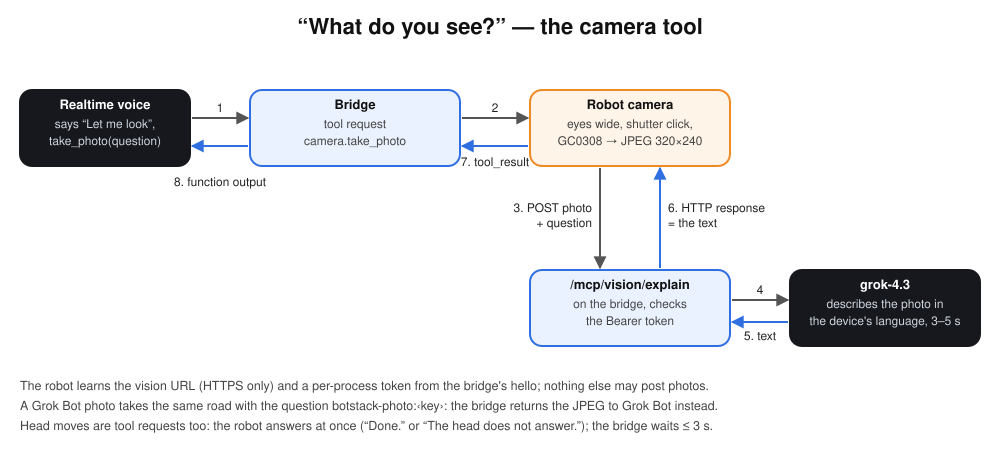

# Robot tools

The voice model has tools. The bridge runs them; those that need the robot become
`expression`, `animation` or `tool` messages on the [botstack/v1](protocol.md) link.

| Tool | What happens |
| --- | --- |
| `set_expression(expression)` | One of the 16 [bloub expressions](face.md), sent to the robot as is. |
| `animate(name)` | `wink`, `wide` or `exclaim`: a [one-shot face animation](face.md#animations). |
| `gesture(name)` | `nod`, `shake`, `look_left`, `look_right`, `look_up`, `center`: a timed series of `head.set_angles` requests. Pitch cannot go below level, so a nod goes up and back. |
| `move_head(yaw, pitch)` | `head.set_angles`, yaw −90…90 (left to right), pitch 0…60 (up). |
| `take_photo(question)` | The camera flow below. |
| `end_conversation()` | The model says goodbye once; the conversation closes 2 s after it is played, with a wink (pushed messages follow). If the model already spoke its goodbye in the same response, the bridge answers the call without asking for another response (otherwise grok-voice-3.0 said goodbye twice). Talking again keeps the conversation open. |
| `ask_grok_bot(question)` | See [Grok Bot](grok-bot.md). |

The model is told to use its body sparingly: an expression when the mood changes, a nod
for yes, not a gesture on every sentence.

## The camera

The bridge's hello gives the robot the vision URL and a token that changes with each
bridge process (approved devices only; a device approved while connected gets a second
hello with them). On `tool camera.take_photo` the robot posts the JPEG and the question
there; `grok-4.3` answers in one or two sentences in the device's language; the answer travels back as the
HTTP response, then as the robot's `tool_result`, then as the function output the voice
model reads aloud. Allow 3–5 seconds.

On the robot, a task of its own powers nothing until asked: it starts the GC0308 stream,
skips 15 frames (0.75 s) for exposure and white balance, encodes one 320×240 frame to JPEG
(quality 80, about 12 kB) in software, stops the stream, and uploads it. The face opens
its eyes wide and the speaker plays a short shutter click, for every photo.

320×240, not 640×480: at VGA the camera driver's task could not copy each 8 kB DMA half
into PSRAM in time while audio ran, and the photo came out torn and dark.

Grok Bot can ask for the same photo with `stackchan_photo` and gets the JPEG itself
instead of a description ([Grok Bot](grok-bot.md#photo-c)).

## The head

Two Feetech SCS0009 servos turn the head: yaw (id 1) and pitch (id 2). The robot answers
`head.set_angles` at once with `Done.` and moves while the conversation goes on; if the
servos have not answered since boot, it says “The head does not answer.” and tries to find
them again every 10 s. The bridge waits for that answer (3 s at most) before it tells Grok,
for `move_head` and the first step of a `gesture`, so Grok never claims a move that did
not happen; a failed robot tool is logged as a warning.

A task on the robot follows each target along a critically damped spring at 50 Hz, like
the StackChan firmware, so a new target never jerks the head; `speed` (0–1000) sets the
stiffness: 200 takes about a second, 500 about a third of a second. One second after the
head comes to rest the torque is released: the servos stop humming into the microphone
and the head can be turned by hand. The next move starts from where it actually is.
When a conversation in which Grok moved the head closes, the bridge sends it back to the
center (yaw 0, pitch 0, speed 250).

Angles are measured from the zero the StackChan firmware calibrated (Setup → servo),
read from NVS namespace `servo` (`zero_pos_1`, `zero_pos_2`) and never written; without
them, the factory values. The robot allows yaw −128…128 and pitch 3…87 degrees; Grok's
tools stay within yaw ±90 and pitch 0…60 (0 becomes 3).
