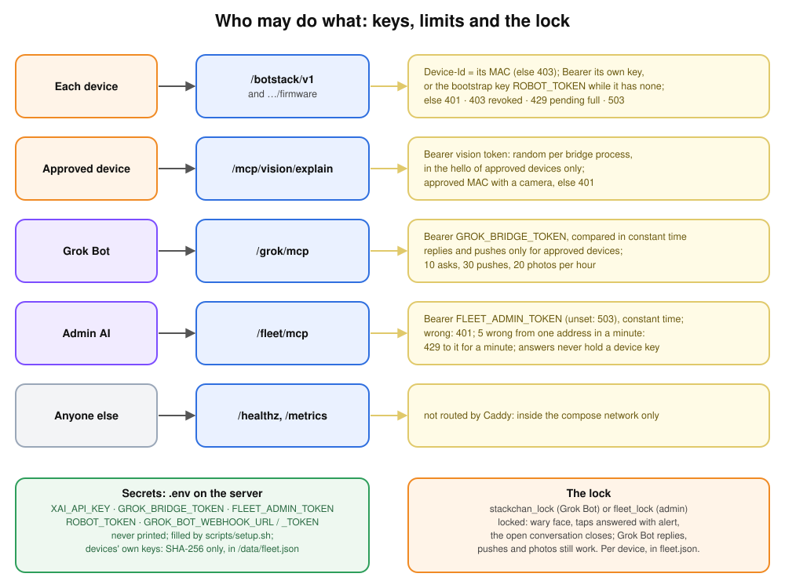

# Security

The bridge's public doors are all behind Caddy (HTTPS); each checks its own credential.

| Door | Who | Checked | Refused with |
| --- | --- | --- | --- |
| `/botstack/v1` | a device | fleet authentication: `Device-Id` and `Authorization: Bearer`, the device's own key or the bootstrap key `ROBOT_TOKEN` (constant time, [fleet](fleet.md#2-keys-and-lifecycle)) | 401, 403 (revoked or not a MAC), 429 (pending list full), 503 (a new pending entry could not be saved) |
| `/botstack/v1/firmware` | a device | the same authentication as the link | 401, 403, 429, 503 |
| `/mcp/vision/explain` | a device | Bearer vision token, random per bridge process and handed over in the `hello` to approved devices only (a pending device gets none; one approved while connected gets a second `hello` with it); the `Device-Id` must be an approved device with a camera; the robot posts only to an HTTPS URL | 401 |
| `/grok/mcp` | Grok Bot | Bearer `GROK_BRIDGE_TOKEN` (constant time) | 401 |
| `POST /grok/callback` | Grok Bot (without MCP) | Bearer `GROK_BRIDGE_TOKEN` (constant time); the reply's `device_id`, when given, must be an approved device; a reply with no device and no default is refused | 401, 400 (unknown device, no default device, bad JSON) |
| `GET /grok/health` | anyone | nothing: it answers `{"ok":true}` and reveals nothing else | none |
| `/fleet/mcp` | admin AI | Bearer `FLEET_ADMIN_TOKEN` (constant time); five wrong tokens in a minute from one client address block that address for a minute | 503 (not set), 401, 429 |

`/healthz` and `/metrics` are not routed by Caddy: they answer inside the compose network
only. Any other path answers 404.

The `/fleet/mcp` lockout counts wrong tokens per client address: the first
`X-Forwarded-For` hop, which Caddy sets (it drops one the client sends), else the socket
peer. A stranger who keeps sending wrong tokens locks out only their own address, not yours.
The bridge tracks up to 1024 addresses; entries older than a minute make room, and when
all are recent, new addresses share one bucket. Without Caddy in front, a client can
choose its own `X-Forwarded-For`, so keep the bridge's port off the internet.

The MAC alone proves nothing (it travels in clear in every Wi-Fi frame), hence the keys.
The **bootstrap key** (`ROBOT_TOKEN`, 64 hex characters) is in the server's `.env` and built
into every image from the gitignored `firmware/robot-token`; it only lets an unknown device
introduce itself as `pending`. Once approved, a device gets an **own key** made by the
bridge and kept in its NVS; the bridge stores only its SHA-256 in `/data/fleet.json`, and
the bootstrap key no longer opens that MAC. No key appears in a log line or an MCP answer.
Anyone holding a device and a USB cable can read the bootstrap key from flash, and its own
key from NVS: revoke or rotate the device (`fleet_revoke`, `fleet_rotate_key`), and rotate
the bootstrap key ([how](firmware.md#the-bootstrap-key-and-the-bridge-url)) if a device
leaves your hands.

A device confirms a new key with `enrolled`, or by connecting with it: that proves it
holds it, even if its `enrolled` was lost. `fleet_rotate_key` refuses while a key is still
on its way to a connected device, so the device and the bridge never end on different
keys.

The vision token is shared by every device, and the vision door trusts the `Device-Id`
the client sends; so only approved devices get it. A pending device (anyone with the
bootstrap key) could otherwise post photos, billed, under the MAC of an approved one.

Accepted risk: someone with the bootstrap key who spoofs the MAC of an approved device
that has no confirmed key yet could receive its key, from the approval to the first
`enrolled`. Acceptable for a lab.

## Firmware updates

The robot installs an update only if it is signed with the key of the firmware it runs
(`firmware/signing-key.pem`, RSA-3072; [updates](firmware.md#updates)). Someone who
controls the bridge or its data volume can offer an image, but not one the robot accepts.
Someone with the robot and a USB cable can flash anything: there is no hardware secure
boot, which would burn eFuses for good.

The images the firmware door serves hold no Wi-Fi secret, so a device that says `hello` with
the bootstrap key and downloads one learns no password. The StackChan reads its networks
from its own NVS; the P4's are written by USB (`firmware-p4/flash.sh`, from the gitignored
`wifi.txt`) into its read-only `wifi_nvs` partition, never into the app image.

## Limits

| Limit | Value |
| --- | --- |
| Grok Bot questions (`ask_grok_bot`) | 10 per hour, for the whole server |
| Pushes (`stackchan_say`) | 30 per hour |
| Photos (`stackchan_photo`) | 20 per hour, 30 s each at most |
| Messages kept while the robot is offline | 5, the oldest dropped |
| Text of a reply or push | 500 characters |
| Request bodies | 64 kB (MCP), 1 MB (photo upload), 64 kB per robot WebSocket frame |

Replies and pushes go only to approved devices; an unknown `device_id` is refused. At most `MAX_CONVERSATIONS` (3) xAI sessions run at once.

## The lock

`stackchan_lock(locked, device_id?)` from Grok Bot, or `fleet_lock` from the admin AI (or
`scripts/fleet.sh fleet_lock '{"device":"desk","locked":true}'`), locks one device (the whole fleet
without a device): nobody can talk to it (a tap or a head touch plays `alert` and opens
nothing), its face stays wary (`mefiant`), and an open conversation closes at once. Grok
Bot replies, pushes and photos still work; a push is not followed by the usual 10 s
listen. The state is per device, in `/data/fleet.json`, so it survives a bridge restart. Details: [Grok Bot](grok-bot.md#lock-d).

A photo always shows: the eyes open wide and the speaker plays a shutter click, so the
camera cannot be used without the people in the room noticing.

## Logs

The bridge's log is personal data: at `info` it records what each person says to the
robot and what Grok answers (the transcripts), the texts read out (Grok Bot replies and
pushes), and each photo's question and the vision model's answer. It never logs a key or
an audio sample. Compose keeps it in Docker's `json-file` log, rotated at 10 MB with three
files per container (`compose.yaml`), until the container is removed (`docker compose
down`). `RUST_LOG=warn` in `.env` keeps the transcripts out.

## Secrets

Never print a key, a token or the webhook URL; report only whether it is set and its
length. On the server they live in `.env` (gitignored, mode 600, written by
`scripts/setup.sh`): `XAI_API_KEY`, `ROBOT_TOKEN` (the bootstrap key), `FLEET_ADMIN_TOKEN`,
`GROK_BRIDGE_TOKEN`, `GROK_BOT_WEBHOOK_URL`, `GROK_BOT_WEBHOOK_TOKEN`. The bridge refuses
an `http://` webhook URL unless `GROK_BOT_WEBHOOK_ALLOW_HTTP=1`, so the webhook key is
not sent in clear by mistake. `.dockerignore`
keeps `.env` (and `.env.*`) out of the image's build context; compose hands the values to
the bridge as its environment.

Change one: edit `.env` (or empty the value and run `scripts/setup.sh` again for a
generated one), then `docker compose up -d`. `scripts/setup.sh` never replaces a value
that is set and never prints one.

On the computer that builds the firmware:

| File | What |
| --- | --- |
| `firmware/robot-token` | the bootstrap key, embedded in every image |
| `firmware/bridge-url` | the bridge's URL (not secret, but yours) |
| `firmware/signing-key.pem` | signs every firmware; the devices install only updates signed with it. Keep a copy somewhere safe: a lost key means the next firmware goes in by USB |
| `firmware-p4/wifi.txt` | the P4 board's Wi-Fi passwords, written by USB only |

All four are gitignored, mode 600 where the scripts create them. Never print them or copy
them into the repository. The bridge logs only whether each secret is set; the firmware
never logs its headers.

Reporting a vulnerability: see [SECURITY.md](../SECURITY.md).
